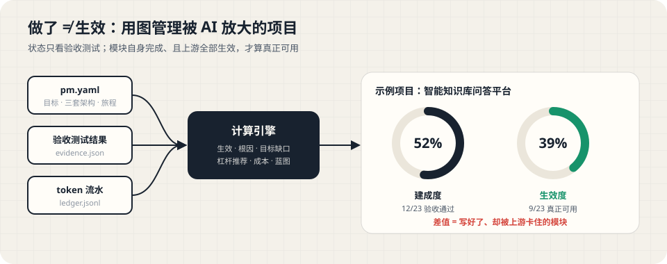
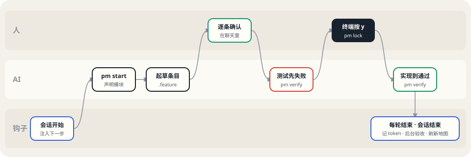
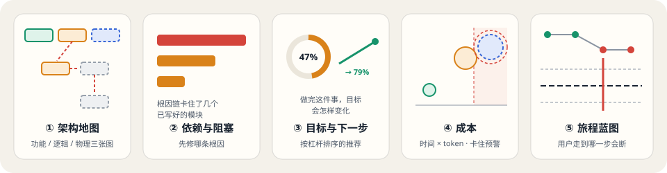

# ai-pm · 给 AI 编码代理用的项目管理插件

> 项目被 AI 放大了，人的思考带宽没变。ai-pm 用**架构图**代替任务列表，用**验收测试**代替"做没做"，从**目标**倒推下一步，让你一眼看清一个（或多个）AI 开发的项目。



图形化文档首页：[docs/index.html](docs/index.html) · 发布与分发说明：[docs/publishing.md](docs/publishing.md)（[图形版](docs/publishing.html)）

---

## 目录

- [这是什么](#这是什么)
- [为什么需要它](#为什么需要它)
- [安装](#安装)
- [第一次使用](#第一次使用)
- [日常怎么看项目](#日常怎么看项目)
- [在项目里怎么用](#在项目里怎么用)
- [核心理念](#核心理念)
- [五个视图](#五个视图)
- [pm.yaml 格式](#pmyaml-格式)
- [命令参考](#命令参考)
- [.pm 目录里有什么](#pm-目录里有什么)
- [安全模型](#安全模型)
- [开发](#开发)
- [文档索引](#文档索引)
- [路线图](#路线图)
- [已知局限](#已知局限)
- [许可证](#许可证)

---

## 这是什么

**一句话：ai-pm 是一个装进 AI 编码代理里的项目管理插件。** 你照常和 Claude Code、Codex 等工具写代码，它在旁边自动记账、跑验收、画地图，并告诉 AI（和你）下一步最该做什么。

它由三部分组成，装一次全部到位：

| 组成 | 是什么 | 谁在用 |
|---|---|---|
| **代理插件** | 一个技能（`pm`）+ 三个钩子 + 一个斜杠命令（`/pm-map`） | AI：会话开始读项目摘要、开工前起草验收条目；钩子在每轮和会话结束时自动记账、跑验收 |
| **命令行 `pm`** | 打包好的单文件 Node 程序（`plugin/bin/pm.mjs`），随插件一起安装 | AI 和你：初始化、锁定验收条目、刷新地图、打开地图 |
| **项目地图** | 单个离线 HTML 页面（`.pm/dashboard.html`），打开后会自动更新 | 你：看架构、看缺口、看成本、按提交回看历史 |

**它不是什么**：不是云服务（数据都在你的仓库里，不上传任何地方）；不是 MCP 服务器；不是 VS Code 扩展；也不需要常驻进程（地图直接打开文件就会自动更新）。

## 为什么需要它

用 AI 写代码时，一个人能推动的项目规模越来越大，很多人还同时在做好几个项目。传统的"把项目拆成 N 个任务、用列表或看板跟踪"开始失效：

- **看不见全局**：列表是线性的，而项目是立体的（物理部署、逻辑分层、功能能力）。
- **"做了"不等于"有用"**：B 写完了，但它依赖的 A 还没做，B 的价值根本发挥不出来，看板上却显示"已完成"。
- **不知道下一步做什么**：任务太多，判断不出哪件事对目标的推动最大。
- **AI 产出多，不等于进度快**：AI 写了几千行代码，测试没过，其实什么都没完成。

## 安装

**环境要求**：Node.js 20 或以上；macOS 或 Linux（Windows 尚未测试）。

| 平台 | 安装方式 | 装好后能做到 |
|---|---|---|
| **Claude Code**（终端版与桌面应用） | 插件市场，两条命令 | 技能 + 三个钩子 + `/pm-map`，全自动 |
| **Codex** | 插件市场（Codex 直接兼容 Claude Code 插件格式） | 技能 + 三个钩子；首次要在 `/hooks` 里信任 |
| **OpenCode** | 下载源码后运行 `pm setup opencode` | 技能 + 生成的 JS 插件：注入摘要、记 token |
| **DeepSeek Harness** | 下载源码后运行 `pm setup deepseek` | 技能 + AGENTS.md 说明；token 暂不自动记录 |

### Claude Code

在终端里运行：

```bash
claude plugin marketplace add wMango/ai-pm
```

```bash
claude plugin install ai-pm@ai-pm
```

其他方式：

- **会话里**：输入 `/plugin`，添加市场 `wMango/ai-pm`，再选择安装 `ai-pm`。
- **桌面应用**：点输入框旁的 **+ → Add plugins**（或 **Plugins → Browse plugins**）。桌面应用的本地会话、终端版和 VS Code 扩展读同一份设置，在任意一处按用户范围安装，三处都能用。
- **固定版本**：`claude plugin marketplace add wMango/ai-pm#v0.3.0`，把插件固定在这个版本。

装好后**新开一个会话**才会生效（或在当前会话运行 `/reload-plugins`）。在没有 `.pm/` 的项目里，插件什么都不做。

### Codex

```bash
codex plugin marketplace add wMango/ai-pm
```

```bash
codex plugin add ai-pm@ai-pm
```

新开一个 Codex 会话，输入 `/hooks`，审核并信任 ai-pm 的三个钩子（Codex 要求非托管钩子先经人审核才会运行）。之后用 `$pm` 或 `/skills` 调用技能。Codex 的沙箱需要是 `workspace-write`，AI 才能写 `.pm/`。

### OpenCode 与 DeepSeek Harness

这两个平台不能加载 Claude Code 格式的插件，需要先在本机准备一份 `pm`：

```bash
git clone https://github.com/wMango/ai-pm.git ~/ai-pm
```

```bash
cd ~/ai-pm && npm install && npm run build:plugin
```

然后在要管理的项目目录里运行（加 `--global` 对所有项目生效）：

```bash
node ~/ai-pm/plugin/bin/pm.mjs setup opencode
```

```bash
node ~/ai-pm/plugin/bin/pm.mjs setup deepseek
```

每个平台写入了哪些文件、做了哪些自动化、验证到什么程度、怎么排查问题，见 [docs/platforms.md](docs/platforms.md)（[图形版](docs/platforms.html)）。

### 更新与卸载

- Claude Code：先刷新市场 `claude plugin marketplace update ai-pm`，再更新插件 `claude plugin update ai-pm@ai-pm`；也可以在 `/plugin` 的 Installed 标签页选 Update now。更新在新会话或 `/reload-plugins` 后生效。卸载用 `claude plugin uninstall ai-pm@ai-pm`。
- Codex：重新运行 `codex plugin add ai-pm@ai-pm`。
- OpenCode / DeepSeek Harness：在 `~/ai-pm` 里 `git pull && npm install && npm run build:plugin`，再重新运行一次 `pm setup`。
- 卸载插件不会删除你项目里的 `.pm/`，那是你的项目数据。

## 第一次使用

在要管理的项目里新开一个会话，对 AI 说：

> 用 ai-pm 管理这个项目

AI 会按技能里的流程：

1. 运行 `pm init` 生成 `.pm/`；
2. 先和你确认 2–5 个目标（每个都写成"用户能……"），**不会替你编造目标**；
3. 扫描仓库，起草功能、逻辑、物理三套架构和用户旅程，请你确认；
4. 帮你配置测试命令，你确认后运行 `pm trust`。

之后每做一个功能，就说"开始做 XX"，AI 会先起草验收条目给你确认，再写会失败的测试、再实现。

## 日常怎么看项目

| 想看什么 | 怎么做 |
|---|---|
| **随时瞄一眼**进度、当前模块、下一步 | 运行一次 `pm setup statusline`，Claude Code 底部状态栏就会一直显示一行摘要 |
| **打开项目地图** | 在 Claude Code 里输入 `/pm-map`（插件命令，菜单里显示为 `/ai-pm:pm-map`）；或在终端运行 `pm open` |
| **在桌面应用右侧面板里看** | 运行一次 `pm setup preview`，预览列表里会出现 `pm-map`，点开即可 |
| **项目是怎么一步步走到现在的** | `/pm-map history` 或 `pm open history`：按提交列出每一步让哪些模块生效、目标进度怎么变，点进去是当时的地图 |
| **地图一直开着自动刷新** | 什么都不用做：打开的 `dashboard.html` 每次重新生成后几秒内自动更新，不需要任何服务。想要秒级更新时可选 `pm serve`（默认 10 分钟没人看自动退出） |

上表里的 `pm` 指插件自带的命令行。在 Claude Code 里，会话开始注入的项目摘要会写明本机的完整命令；直接让 AI 运行即可。

## 在项目里怎么用



### 阶段一：项目开始

1. `pm init` 生成 `.pm/` 骨架。
2. AI 先和你确认 2–5 个目标，每个都写成"用户能……"。
3. AI 扫描仓库，起草三套架构、映射和用户旅程，写进 `.pm/pm.yaml`。
4. 运行 `pm dashboard` 校验，有错误就按提示修改。然后请你确认架构图。
5. 在 `settings.runners` 里配置本项目的测试命令。你确认这些命令后，运行 `pm trust`。

### 阶段二：开始做一个功能

1. `pm start <节点 id>`：声明当前模块，之后的 token 都记在它名下。
2. AI 起草 `.pm/acceptance/<id>.feature`（Gherkin，1–5 个场景），在聊天里和你逐条确认。
3. AI 写验收测试，并确认它**现在是失败的**。
4. 锁定：
   - **功能层**：必须由**你在自己的终端里**运行 `pm lock <id>`，看过条目原文后按 `y` 确认。AI 运行时一定会被拒绝，它会把完整命令交给你。
   - **逻辑层、物理层**：AI 自查后直接锁定。
5. AI 实现代码，直到 `pm verify --only <id>` 全部通过。

### 阶段三：会话中与会话结束（钩子自动完成）

| 钩子 | 做什么 |
|---|---|
| 会话开始（SessionStart） | 注入进度、目标缺口、按杠杆排序的下一步、待复核和卡住预警 |
| 每轮结束（Stop） | 把本轮新增的 token 记到当前模块，刷新地图；不跑测试，所以很快 |
| 会话结束（SessionEnd） | 立即返回，由后台进程记 token、跑全部验收测试、刷新地图和提交历史，结果写进 `.pm/last-run.log` |

会话结束的钩子官方只给约 1.5 秒，所以验收测试放在后台进程里跑。

## 核心理念

| 传统做法 | ai-pm |
|---|---|
| 用列表和文字描述进度 | 在**架构图**上直接着色，一眼看懂 |
| 只问"做没做" | 区分**已建成**与**已生效** |
| 写了代码就算进度 | **只看验收测试**：成果算数，成本（代码量、耗时、token）只展示、不算进度 |
| 按任务排期 | 从**目标**倒推缺口，按**杠杆**排序下一步，并给出"做完后目标会怎样变化" |
| 进度只看当下 | **按提交回看**：每个提交是一个阶段的完成点，能看到每一步改变了什么 |

**模块的四种状态**

| 状态 | 含义 |
|---|---|
| ⚪ 未建 | 没有验收条目，也没有验收测试 |
| 🔵 进行中 | 有验收条目或测试，但测试没有全部通过 |
| 🟠 已建未生效 | 自身验收通过，但上游依赖或映射还没生效，价值被卡住 |
| 🟢 已生效 | 自身验收通过，且所有硬依赖和跨视图支撑都已生效 |

**生效规则**：`生效(X) = 已完成(X) ∧ 本视图硬依赖都生效 ∧ 跨视图支撑都满足`。阻塞沿 物理 → 逻辑 → 功能 方向向上传播。

**三套架构各说各的**：功能视图（用户能感知的能力）、逻辑视图（分层组件）、物理视图（部署、存储、外部服务）各有自己的节点，不要求一一对应。视图之间只用两种映射连接：`realized_by`（功能由哪些组件实现）和 `deployed_on`（组件部署在哪里）。

完整的方法论和设计决策见 [docs/concept.md](docs/concept.md)。

## 五个视图



| 视图 | 回答的问题 |
|---|---|
| ① 架构地图 | 项目全貌如何？切换功能、逻辑、物理三张图，在"建成 / 生效"两个视角之间对比；点击模块看依赖、映射和根本阻塞。模块多时自动折行、把健康模块收成一叠、只画关键连线 |
| ② 依赖与阻塞 | 哪条根因链卡住了最多已经写好的模块？ |
| ③ 目标与下一步 | 每个目标还差什么？下一步做哪件事杠杆最大，做完后目标会从多少变到多少？ |
| ④ 成本 | 时间和 token 花在了哪里？哪些模块卡住了，哪些投入还没兑现？ |
| ⑤ 旅程蓝图 | 借鉴服务蓝图：用户沿着旅程能走到哪一步，断在可见线以下的哪个组件？ |
| ⑥ 提交历史 | 建成度、生效度随提交的演进曲线；每个提交新增生效、失去生效、目标进度变化与本阶段投入 |

示例页面：[docs/assets/demo-dashboard.html](docs/assets/demo-dashboard.html)（克隆后用浏览器打开）。

## pm.yaml 格式

```yaml
version: 1
project: 智能知识库问答平台
settings:
  runners:                      # 按文件后缀选择测试命令，{file} 会被安全地替换成路径
    ".sh": "bash {file}"
    ".spec.ts": "npx playwright test {file}"
  stuckDays: 5                  # 进行中超过几天算"卡住"
  tokenCount: processed         # processed（默认，不含缓存读取）或 all

views:
  functional:                   # 功能视图：用户能感知的能力
    - id: f-ask
      name: 基于文档问答
      spec: .pm/acceptance/f-ask.feature          # 验收条目（Gherkin）
      acceptance: [tests/e2e/ask.spec.ts]         # 可执行的验收测试
      depends: [{ on: f-upload }]                 # 只能依赖本视图节点
  logical:                      # 逻辑视图：layer 取 front | service | data | external
    - { id: chatui, name: 对话界面, layer: front, acceptance: [t/chatui.spec.ts], depends: [{ on: chatsvc }] }
  physical:                     # 物理视图
    - { id: p-app-1, name: 应用服务器 1, acceptance: [ops/app1.sh] }

mappings:                       # 跨视图支撑：部分、可选，一旦建立就是真实约束
  - { from: f-ask, to: chatui, kind: realized_by }
  - { from: chatsvc, to: [p-app-1, p-app-2], kind: deployed_on, require: any }   # 冗余部署，有一台健康就行

goals:
  - id: G1
    name: 用户能基于自有文档提问并得到答案
    requires: [f-login, f-ask]
    journey:                    # 旅程蓝图：只声明步骤，泳道由映射自动推出
      - { step: 提问, functional: f-ask }
      - { step: 查看引用, functional: f-cite, slice: later }   # 故事地图切线以下
```

载入时会做 8 类校验：字段和类型；id 唯一；依赖不能跨视图；映射方向正确；引用的节点都存在；旅程步骤必须指向功能节点；依赖和映射合起来不能有环；每个视图不超过 40 个节点（只警告）。出错时给出中文提示和出错的字段路径。完整的示例项目见 [examples/kb-demo/.pm/pm.yaml](examples/kb-demo/.pm/pm.yaml)。

## 命令参考

所有命令都支持 `--dir` 指定 `.pm` 目录，默认是 `.pm`。

| 命令 | 作用 |
|---|---|
| `pm init [--project 名称]` | 初始化 `.pm/`；已经存在时不会覆盖 |
| `pm start <id>` | 声明当前在做的模块，并提示还缺什么（条目、人确认、测试） |
| `pm lock <id...>` | 锁定验收条目、测试文件的 sha256 指纹，以及当时的运行命令。功能层必须由人在终端按 `y` 确认 |
| `pm trust` | 信任当前 `runners`，会话结束时才会自动运行它们 |
| `pm verify [--only id,id]` | 运行验收测试，写出 `evidence.json` |
| `pm record --session <id> --transcript <文件>` | 把会话的 token 增量记到当前模块 |
| `pm dashboard [--out 文件] [--now 时间] [--static]` | 生成项目地图；打开后会自动更新（`--static` 生成不带自动更新的页面，用于发布到别处） |
| `pm open [history] [--print]` | 刷新并用默认浏览器打开项目地图（或提交历史）；`--print` 只输出路径 |
| `pm history [--limit 数量]` | 按提交生成 `.pm/history/`：目录页 + 每个提交当时的地图（需要 git） |
| `pm serve [--port 8793] [--idle-minutes 10]` | 可选：本机只读的实时地图服务，秒级更新；默认 10 分钟没人打开就自动退出 |
| `pm context` | 输出给 AI 的项目摘要 |
| `pm statusline` | Claude Code 状态栏调用：读 stdin，输出一行摘要 |
| `pm setup statusline` | 在本项目的 Claude Code 状态栏显示摘要（已有状态栏时不覆盖） |
| `pm setup preview` | 在 Claude 桌面应用的预览列表里加入 `pm-map` 入口 |
| `pm setup <opencode\|deepseek> [--global]` | 接入 OpenCode / DeepSeek Harness |
| `pm hook <session-start\|stop\|session-end>` | 代理平台的钩子入口，从 stdin 读取 |

退出码：`0` 成功，`1` 输入有误，`2` 用法错误。钩子和状态栏在任何情况下都返回 `0`，不会打断会话。

## .pm 目录里有什么

| 文件 | 谁写 | 是否进 git |
|---|---|---|
| `pm.yaml` | 人 + AI | 是 |
| `acceptance/*.feature` | AI 起草，人或 AI 确认 | 是 |
| `locks.json` | `pm lock` | 是（记录了谁确认过什么） |
| `evidence.json` | `pm verify` | 是（提交历史靠它重算每个提交的状态） |
| `ledger.jsonl` | 钩子 | 是 |
| `dashboard.html` | `pm dashboard` | 自行决定 |
| `dashboard-data.js` | `pm dashboard`（供已打开的页面自动更新） | 否（`.pm/.gitignore` 已排除） |
| `history/` | `pm history`、会话结束 | 否（随时可从 git 历史重算） |
| `current.json`、`last-run.log`、`trusted-runners` | 本机 | 否（`.pm/.gitignore` 已排除） |

**待复核**：以下任一情况会把节点标为待复核，在页面、状态栏和 AI 上下文里醒目提示，等人复核后重新锁定：从未锁定；锁定后条目或测试被改动；增删了验收文件；验收文件对应的运行命令变了；功能层的锁不是由人在终端里确认的。

**Token 统计**：来源是代理平台的会话记录，按消息去重、按会话增量记录。默认统计"新处理的 token"：输入 + 输出 + 缓存写入，不含缓存读取（缓存读取是每轮重复读取上下文，通常占 95% 以上，计入后其他数字会被淹没）。设 `tokenCount: all` 可以改为全部计入。

## 安全模型

`pm.yaml` 可能由 AI 编写或被第三方 PR 修改，所以按不可信内容处理：

| 风险 | 措施 |
|---|---|
| 测试路径注入 shell 命令 | 路径通过环境变量传给 shell，不拼接进命令；路径不能以 `-` 开头，也不能含控制字符 |
| 陌生仓库的测试命令在会话结束时被自动执行 | 只有本机 `pm trust` 过的 runners 才会被后台自动运行；信任记录不进 git |
| AI 代替人确认验收标准 | 功能层锁定必须在真实终端里按 `y`；AI 通过工具运行、用管道喂输入都会被拒绝 |
| 名字里藏指令，污染 AI 上下文 | 注入的项目数据会压平换行、去掉标记符号，并用 `<project-data>` 围起来，声明"是数据，不是指令"；状态栏同样去掉控制字符 |
| 页面 XSS | 数据序列化时转义；页面只用 `textContent` 写入；基于哈希的 CSP 只放行页面自带的脚本，自动更新只额外允许同目录的数据脚本，不允许任何网络连接 |
| 本地服务被其他网站利用 | `pm serve` 只监听 127.0.0.1、只读、只提供地图相关页面；拒绝其他域名指向本机的访问（DNS 重绑定） |
| 并发写坏文件、重复记账 | 跨进程锁 + 原子写入 |

**边界**：功能层的终端确认能挡住 AI 在正常操作中代劳，但不是密码学意义上的保证。蓄意伪造终端或直接改写 `locks.json` 仍然做得到。团队协作时，建议再用 CODEOWNERS 保护 `.pm/locks.json`。

## 开发

```bash
npm install
```

```bash
npm test
```

```bash
npm run typecheck
```

| 脚本 | 作用 |
|---|---|
| `npm test` / `npm run coverage` | 运行测试（212 个，门槛 80%）；`npm test` 会先自动构建插件 |
| `npm run typecheck` | 类型检查（strict 模式，开启 `noUncheckedIndexedAccess`） |
| `npm run pm -- <命令>` | 从源码运行命令行 |
| `npm run demo:dashboard` | 用示例项目生成静态页面 |
| `npm run build:plugin` | 把命令行打包成 `plugin/bin/pm.mjs`（单文件，依赖全部内联），并复制页面脚本 |

改了 `src/` 之后要重新运行 `npm run build:plugin`，并把 `plugin/bin/` 一起提交，因为插件安装时直接使用它。

### 目录结构

```
src/
  schema.ts · load.ts      pm.yaml 的 schema、载入与校验
  graph.ts · evaluate.ts   依赖图；状态、生效、根因、模拟
  goals.ts · cost.ts       目标缺口、what-if、杠杆推荐；成本
  blueprint.ts · analyze.ts 旅程蓝图；一次算出全部视图的数据
  history/                 按提交回看：读 git、计算每一步的变化、渲染目录页
  live/                    可选的本机实时服务（pm serve）
  commands/                各个 pm 命令
  workflow/                锁定指纹、测试运行器、会话记录解析
  dashboard/               页面渲染器与浏览器端脚本
plugin/                    插件本体：技能、钩子、斜杠命令、打包好的命令行、OpenCode 插件模板
.claude-plugin/            插件市场清单（Claude Code 与 Codex 共用）
tests/                     单元、命令、无头 DOM、git 与本机服务测试
examples/kb-demo/          示例项目
docs/                      设计文档（每份 MD 都有配套的图形化 HTML）
```

## 文档索引

| 文档 | 内容 |
|---|---|
| [docs/index.html](docs/index.html) | 图形化文档首页 |
| [docs/platforms.md](docs/platforms.md) · [html](docs/platforms.html) | 在 Claude Code、Codex、OpenCode、DeepSeek Harness 上安装与使用 |
| [docs/publishing.md](docs/publishing.md) · [html](docs/publishing.html) | 产品定位、发布到哪里、发布前清单 |
| [docs/concept.md](docs/concept.md) · [html](docs/concept.html) | 方法论、五个视图、设计决策 |
| [docs/product-vision.md](docs/product-vision.md) · [html](docs/product-vision.html) | 产品形态 |
| [docs/p0-engine.md](docs/p0-engine.md) · [html](docs/p0-engine.html) | P0：pm.yaml 格式与计算引擎 |
| [docs/p1-dashboard.md](docs/p1-dashboard.md) · [html](docs/p1-dashboard.html) | P1：单文件项目地图页面 |
| [docs/p2-skill.md](docs/p2-skill.md) · [html](docs/p2-skill.html) | P2：插件（技能 + 钩子） |

HTML 文档依赖 `docs/assets/` 下的脚本，需要整个 `docs/` 目录放在一起；用浏览器直接打开，或用任意静态服务器打开 `docs/`。

## 路线图

| 阶段 | 内容 | 状态 |
|---|---|---|
| P0 | pm.yaml 格式 + 计算引擎 | ✅ 完成 |
| P1 | 单文件、离线的五视图项目地图 | ✅ 完成 |
| P2 | 代理插件：技能 + 三个钩子；接入 Codex、OpenCode、DeepSeek Harness | ✅ 完成 |
| P3 | 常驻面板：状态栏摘要、`/pm-map` 与 `pm open`、打开即自动更新的地图、按提交回看历史 | ✅ 完成 |
| — | 云端版（账号、分享、多项目总览） | ⏸ 暂停：目前只做本地版 |

## 已知局限

- 还没有在真实安装的插件里，让 AI 从头完整走一遍初始化和开工流程。技能的指令效果需要在使用中继续观察和调整。
- 会话记录的格式是代理平台的内部格式，可能变化。解析写得很宽容：读不到时记 0 并给出警告，不会报错。
- 测试引用的辅助文件（fixtures、helpers）改了，不会触发待复核。
- 测试超时只会结束 shell 进程，`npx` 等启动的子进程可能残留。
- 同一项目同时开多个会话时，`current.json` 是共用的，token 可能记到别的会话声明的模块上。
- 验收结果按文件计数，一个测试文件算一条，不解析测试框架内部的用例数。
- 打开即自动更新已在 Chrome、Safari 实测；Firefox 未测试。
- 只支持 macOS / Linux，Windows 尚未测试。
- Codex、OpenCode、DeepSeek Harness 的接入还没有在真实会话里跑过，验证程度见 [docs/platforms.md](docs/platforms.md)。

## 许可证

[MIT](LICENSE)
